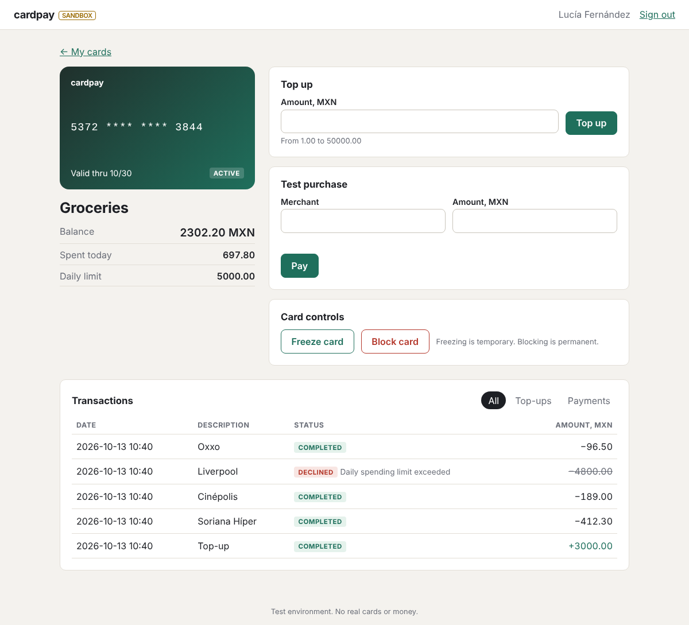
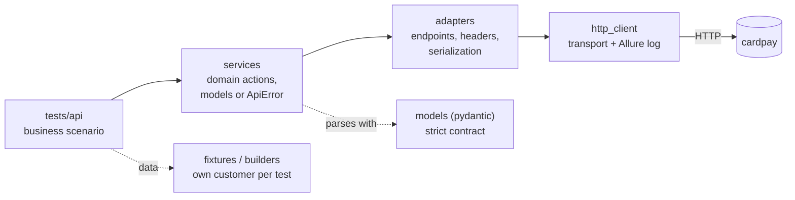

# demo-sandbox-plata

[](https://github.com/7jarvis/demo-sandbox-plata/actions/workflows/ci.yml)
[](https://7jarvis.github.io/demo-sandbox-plata/)

Python test automation for a card-payments product: API and web UI tests,
test documentation and CI, together with the small service they test.

My production test code lives in private repositories under NDA, so this
is a compact, runnable demo of how I work: risk-based test design, a
layered API framework with strict contract models, Page Object Model with
locators taken from the real page, smoke/regression suites in CI, an
Allure report on GitHub Pages, and test documentation that is linked to
the automated tests. A Go counterpart of the API side is in
[tradebench](https://github.com/7jarvis/tradebench).

```
app/       card sandbox: web UI + JSON API (system under test)
tests/     pytest framework, API tests (166) and UI tests (19)
docs/      test strategy, test cases, checklists, metrics, OpenAPI contract (RU)
scripts/   traceability check, page inspection for writing locators
```

## Quick start

Requires Docker and Python 3.12.

```bash
make up            # build and start the app on http://localhost:8000
make install       # test dependencies + Chromium
make smoke         # 18 critical-path tests, API + UI
make regression    # full suite, 185 tests
make report        # open the Allure report of the run
make down
```

Open http://localhost:8000, register with any `+52` and 10 digits phone;
the sandbox one-time code is `111111`.

## The system under test



Virtual debit cards with the rules that make card products easy to get
wrong:

- **Sign-in by one-time code**: single use, three attempts, the code
  request does not reveal whether a phone is registered.
- **Cards**: at most three cards that are not blocked; a daily spending
  limit per card.
- **Top-ups and payments** in MXN, money as two-decimal strings on the
  wire. A declined payment is a normal outcome: it is recorded with a
  reason (`CARD_BLOCKED` → `CARD_FROZEN` → `DAILY_LIMIT_EXCEEDED` →
  `INSUFFICIENT_FUNDS`) and does not move money.
- **Idempotency**: every money request carries an `Idempotency-Key`; a
  retry returns the original transaction, the same key with another body
  is rejected.
- **Freeze** is temporary, **block** is permanent and keeps the balance.
- **Concurrency**: money moves inside `BEGIN IMMEDIATE` transactions, so
  parallel payments cannot overdraw a card.
- Another customer's card answers exactly like a missing one (404).

Starlette + SQLite, one container. The contract is
[`docs/openapi.yaml`](docs/openapi.yaml).

## API test framework

A test talks to a business-level service and knows nothing about HTTP.



| Layer | Responsibility |
|---|---|
| `http_client` | The only module that imports `requests`. Attaches every exchange to Allure with an `X-Request-Id` the service also logs; tokens are masked. |
| `adapters` | Method, path, auth and idempotency headers, JSON serialization. |
| `services` | `AuthService`, `CardsService`: `pay()`, `top_up()`, `block()`... The expected status becomes a model; a documented 4xx becomes `ApiError`; a 5xx, an unexpected status or a body that breaks the contract is an `UnexpectedResponse`, so a server bug never passes for an expected rejection. |
| `models` | `extra="forbid"`, strict JSON types, formats for money/ids/timestamps, invariants (a declined transaction has a reason and no balance; a blocked card has a block reason). |

```python
@case("TC-PAY-03")
def test_payment_above_balance_is_declined(customer, funded_card):
    card = funded_card(balance="100.00")

    txn = customer.cards.pay(card.id, money.add("100.00", "0.01")).transaction

    assert (txn.status, txn.decline_reason, txn.balance_after) == ("declined", "INSUFFICIENT_FUNDS", None)
    updated = customer.cards.get(card.id)
    assert (updated.balance, updated.spent_today) == ("100.00", "0.00")
    assert customer.cards.history(card.id, type="payment").items == [txn]
```

## UI tests

Page objects hold locators and actions; tests hold the assertions
(Playwright `expect`, auto-waiting, no sleeps). Locators were chosen from
the accessibility tree of the running pages and checked to match exactly
one element: role + accessible name, then label, then `data-testid` for
values without a role. Forms on the card page are components scoped to
their region, because the page has two "Amount, MXN" fields; "Freeze card"
uses an exact name because the default substring match also finds
"Unfreeze card".

Preconditions are created through the API and the browser is signed in
through the login forms' request API, so a UI test spends its time on the
behavior under test. Field errors are asserted as accessible descriptions,
which also checks that the message is attached to its field. A failing UI
test gets a screenshot in Allure and a Playwright trace in the CI
artifacts.

## Test design and documentation

The [test strategy](docs/test-strategy.md) starts from risks (double
charge, overdraft under concurrency, access to another customer's card,
payments on frozen/blocked cards...) and maps each to tests.

| Area | Covered |
|---|---|
| Registration / sign-in | normalization, duplicates, field formats and boundaries, wrong code and attempts, lockout, single-use code, no user enumeration |
| Cards | defaults, daily limit and label boundaries, three-card limit, blocked card frees a slot |
| Top-ups | amount boundaries and formats, balance cap, idempotent retry, key reuse with another body/card, keys scoped per customer |
| Payments | debit and spent-today, exact balance, decline reasons and their order, daily limit boundary, declines do not use the limit, replay of a declined payment |
| Card status | freeze/unfreeze, permanent block with each reason, every transition out of `blocked` refused |
| History | order, running balance, filters, pagination, parameter validation |
| Security / contract | no or bad token on every endpoint, another customer's card on every endpoint, malformed and oversized bodies, unknown fields, money as JSON numbers, error shape, request id |
| Concurrency | 10 simultaneous payments with money for 3 → exactly 3 completed, balance 10.00; 10 simultaneous retries of one top-up → credited once |

[`docs/`](docs/README.md) (in Russian) holds 74 test cases in business
terms with steps written as actions, checklists, the smoke/regression
rules and quality metrics. Every automated test is tagged with its case
(`@case("TC-PAY-03")`), which becomes a link in Allure, and
[`scripts/check_traceability.py`](scripts/check_traceability.py) fails CI
when a test and its case drift apart.

The concurrency test was checked by mutation: replacing `BEGIN IMMEDIATE`
with a deferred transaction in the service makes it fail. The narrow-screen
checklist item found a real layout bug, fixed in its own commit.

## CI

[`.github/workflows/ci.yml`](.github/workflows/ci.yml):

1. **lint + collect**: ruff, mypy, traceability check, test collection per
   suite.
2. **smoke**: `docker compose up --wait`, `pytest -m smoke` (API + UI).
3. **regression**: the full suite, only after a green smoke.
4. **report**: Allure reports for both suites with trend history, deployed
   to [GitHub Pages](https://7jarvis.github.io/demo-sandbox-plata/).

Each suite publishes a JUnit check, Allure results, Playwright traces of
failed UI tests and the app log.

## Working with AI agents

Tests here were written with an AI agent working under my own
instructions: read the contract and existing tests first, write a plan and
test design before code, reuse the layers, take UI locators from the live
page (Playwright MCP, or `scripts/inspect_page.py`, which prints the
accessibility tree and counts matches), run quality gates including
proving a new test can fail, then self-review.

The agent drafts, I review every change. It helps most with enumerating
cases from a contract and boilerplate inside an established architecture;
it does not decide what the expected behavior is.
